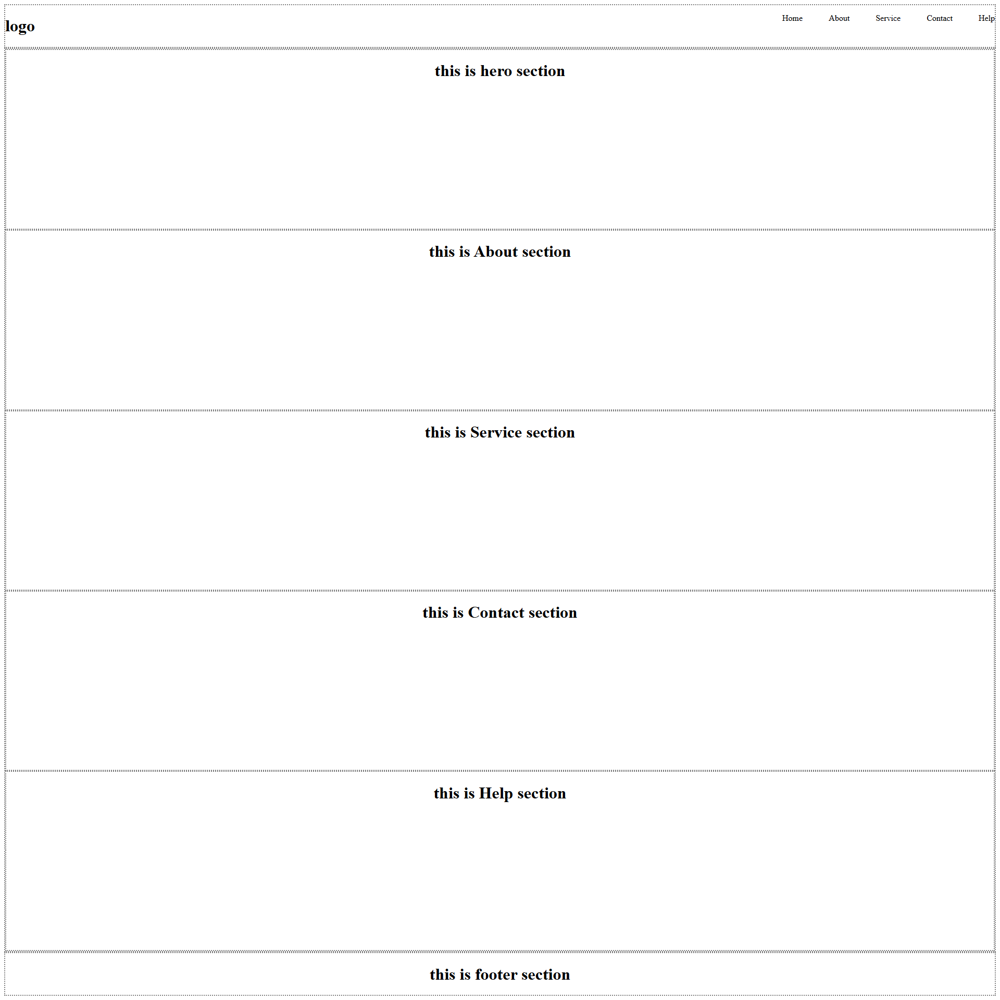

LIVE URL:- https://codepen.io/editor/cafzrngz-the-decoder/pen/01a0f77b-0b90-763f-8d1b-b1dc03bf66d9

# HTML Wireframe Website

A simple HTML and CSS project demonstrating the basic structure of a website using semantic HTML elements such as `header`, `nav`, `main`, `section`, and `footer`.

## 📌 Project Overview

This project creates a basic website wireframe layout. It focuses on understanding how different HTML elements are structured to create the layout of a webpage.

The page contains:

- Header with logo and navigation menu
- Hero section
- About section
- Service section
- Contact section
- Help section
- Footer

## 🛠️ Technologies Used

- HTML5
- CSS3

## 📂 Project Structure

```text
HTML-Wireframe/
│
├── index.html
└── README.md
```

## ✨ Features

### Header

The header contains:

- Website logo
- Navigation menu
- Home
- About
- Service
- Contact
- Help

### Hero Section

A basic hero section is created using the `<section>` element.

```html
<section id="hero">
  <h1>This is hero section</h1>
</section>
```

### Content Sections

The website contains separate sections for:

- About
- Service
- Contact
- Help

Each section is identified using an `id`.

### Footer

A footer section is added at the bottom of the webpage.

## 🎨 CSS Concepts Used

This project demonstrates some basic CSS concepts:

### Border

Dotted borders are added to major page sections to make the wireframe structure visible.

```css
header,
main,
footer,
section {
  border: 2px dotted gray;
}
```

### Flexbox

Flexbox is used to arrange the navigation elements horizontally.

```css
nav {
  display: flex;
  justify-content: space-between;
}
```

### Gap

Spacing between navigation items is created using the `gap` property.

```css
ul {
  display: flex;
  gap: 50px;
}
```

### List Styling

Default bullet points are removed from the navigation list.

```css
li {
  list-style: none;
}
```

## 🚀 How to Run

1. Download or clone this project.
2. Open the project folder.
3. Open `index.html` in any modern web browser.

No additional installation or dependencies are required.

## 🎯 Learning Objectives

After completing this project, you should understand:

- Basic HTML document structure
- Semantic HTML elements
- Header and footer structure
- Navigation menus
- HTML sections and IDs
- Basic CSS styling
- CSS Flexbox
- Spacing using `gap`
- Removing default list styles

## 🔮 Future Improvements

You can improve this project by adding:

- Responsive design
- Working navigation links
- Better typography
- Colors and backgrounds
- Hover effects
- Mobile navigation menu
- Images and icons
- Responsive layouts using CSS Media Queries

## 📄 License

This project is created for learning and educational purposes.


